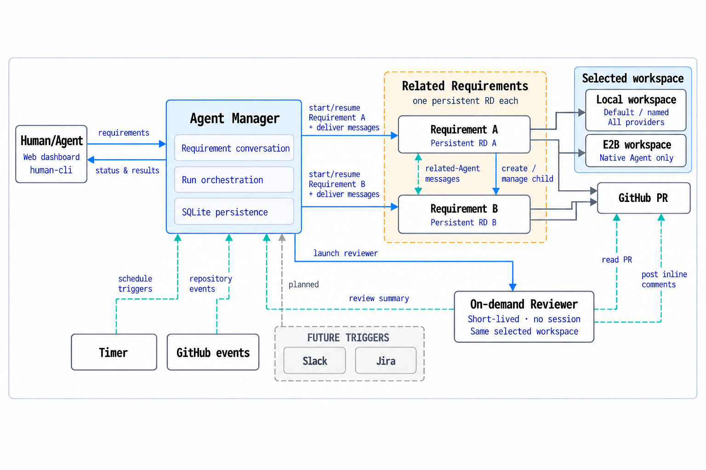

  

  
  
  <a href="packages/agent-manager/package.json">=22.19.0" /></a>
  

https://github.com/user-attachments/assets/80896c78-c804-4c3d-98df-75ccc68031f3

Code Factory connects requirements, coding agents, and GitHub pull requests. Organize work as a requirement tree and collaborate with Codex, Claude Code, or Native Agent through the web dashboard or human CLI.

## Quick Start

Requires **Node.js 22.19+**. See [agent CLI and GitHub setup](docs/running-code-factory.md#prerequisites) or [Native Agent authentication](docs/native-agent.md#model-authentication).

~~~bash
cd /path/to/the/repository/to-manage
npx --package @luoyixin/code-factory code-factory-agent-manager start --daemon
~~~

The startup directory becomes the default workspace. Open [http://127.0.0.1:4310](http://127.0.0.1:4310), create a requirement, and select an agent.

Headless agents run with your permissions. Use trusted repositories and restrict dashboard access to trusted users.

## How It Works

Each requirement has a persistent agent session. Humans can steer the agent, request PR reviews, and confirm completion. On-demand reviewers use the requirement's workspace. All three agent providers support local workspaces, and Native Agent also supports E2B sandboxes.

  

[Diagram source (Mermaid)](docs/assets/brand/code-factory-overview.mmd)

### Bring Your Own Harness

Code Factory launches your locally installed Codex or Claude Code CLI in the requirement's workspace. Each CLI uses its own discovery rules to load your settings, skills, and enabled memory, so those capabilities carry over to tasks started from Code Factory.

Code Factory passes the requirement context and workflow instructions. It does not inject or maintain additional memory or skills.

## Documentation

- [Running Code Factory](docs/running-code-factory.md), [Human CLI](docs/running-code-factory.md#human-management-cli), and [Tailscale remote access](docs/tailscale.md)
- [Architecture](docs/architecture.en.md), [Headless Agent Runner](docs/agent-runners.md), and [Native Agent guide](docs/native-agent.md)
- [HTTP API reference](docs/agent-manager-api.md) and [event protocol](docs/protocol.md)
- [Development guide](docs/development.md), [release guide](docs/releasing.md), and [roadmap](docs/roadmap.md)

## License

[Apache License 2.0](LICENSE).
