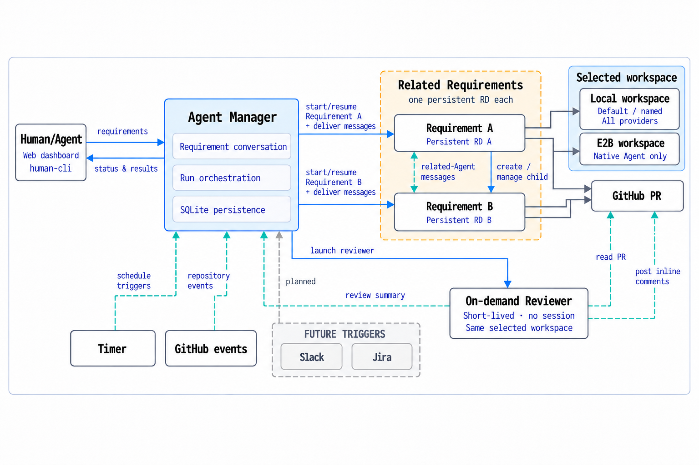

  

<h1 align="center">Code Factory</h1>

<strong>A tree-based collaboration platform for requirements, coding-agent teams, and humans.</strong>

  
  
  <a href="packages/agent-manager/package.json">=22.19.0" /></a>
  

https://github.com/user-attachments/assets/80896c78-c804-4c3d-98df-75ccc68031f3

Code Factory brings requirements, coding agents, and GitHub pull requests into one control plane, accessible through the **Web dashboard** or **human CLI** (`code-factory-human-cli`). Organize work as a requirement tree and collaborate with **Codex**, **Claude Code**, or **Native Agent** through conversation.

Each requirement has its own persistent agent context. Jev stops automatic recovery after two consecutive failed or timed-out RD Runs; a successful Run starts a fresh failure streak. Agents can split work into child requirements and work in parallel, while humans steer the work, request reviews, and confirm completion.

Native Agents using E2B can check, pause, and resume their selected sandbox and transfer files between the host and sandbox, including conversation attachments. Pausing preserves remote state while the Agent continues on the host.

Codex, Claude Code, and Native RD Agents can explicitly publish generated files as conversation attachments. Remote browser users can download them from the conversation; file bytes stay outside model context during publication. Human uploads and Agent-published attachments are reclaimed after 7 days by default; change the retention period in Settings without restarting. Message text remains available.

Requirement details include collapsible tool calls with arguments, results, and execution status, plus a live working indicator. Both follow the dashboard's light/dark theme and English/Simplified Chinese language setting.

## How It Works

  

[Diagram source (Mermaid)](docs/assets/brand/code-factory-overview.mmd).

Local workspaces support Codex, Claude Code, and Native Agent; E2B workspaces support Native Agent. Each requirement keeps one persistent RD session, and its on-demand Reviewer uses the same selected workspace.

## Quick Start

Requires **Node.js 22.19+**. See [Running Code Factory](docs/running-code-factory.md) for agent CLI and GitHub setup, or the [Native Agent guide](docs/native-agent.md) for API profile configuration.

~~~bash
cd /path/to/the/repository/to-manage
npx --package @luoyixin/code-factory code-factory-agent-manager start --daemon
~~~

Open [http://127.0.0.1:4310](http://127.0.0.1:4310), create a requirement, and select an agent to begin. The startup directory becomes the default workspace; the dashboard is bundled with Agent Manager.

Unsent conversation text and attachments return when you reopen a requirement or reload the dashboard in the same browser.

For human-directed terminal management, use `npx --package @luoyixin/code-factory code-factory-human-cli --help`. The CLI and companion [skill](skills/code-factory-human-cli/SKILL.md) support search, requirement inspection, human replies, lifecycle actions, PR reviews, and timers. See [CLI usage](docs/running-code-factory.md#human-management-cli).

E2B sandbox creation defaults to the `e2b.app` domain when left blank and connects an execution environment without preparing a repository; the Native Agent chooses and clones the task repository when needed. Optional sandbox environment variables supply tokens and build settings to Native Agent commands. You can edit them during a Run; the next RD or Reviewer command uses the latest values, while running commands and background processes need a restart. See the [Native Agent guide](docs/native-agent.md).

Headless agents inherit your filesystem, network, and command permissions. Run Code Factory in trusted repositories and limit dashboard access to trusted users.

## Documentation

- [Running Code Factory](docs/running-code-factory.md) — prerequisites, configuration, CLI options, and daemon operation.
- [Tailscale remote access](docs/tailscale.md) — access the dashboard from another device.
- [Architecture and domain model](docs/architecture.en.md) — requirement lifecycle, sessions, messaging, and review workflow.
- [Headless Agent Runner](docs/agent-runners.md) — Codex and Claude Code integration.
- [Native Agent guide](docs/native-agent.md) — API profiles, tools, and E2B sandboxes.
- [E2B lifecycle and readiness audit](docs/e2b-lifecycle-audit.md) — current lifecycle, control ownership, and capability gaps.
- [HTTP API reference](docs/agent-manager-api.md) and [event protocol](docs/protocol.md).
- [Development guide](docs/development.md) — source installation, builds, and checks.
- [Release guide](docs/releasing.md) and [roadmap](docs/roadmap.md).

## License

[Apache License 2.0](LICENSE).
