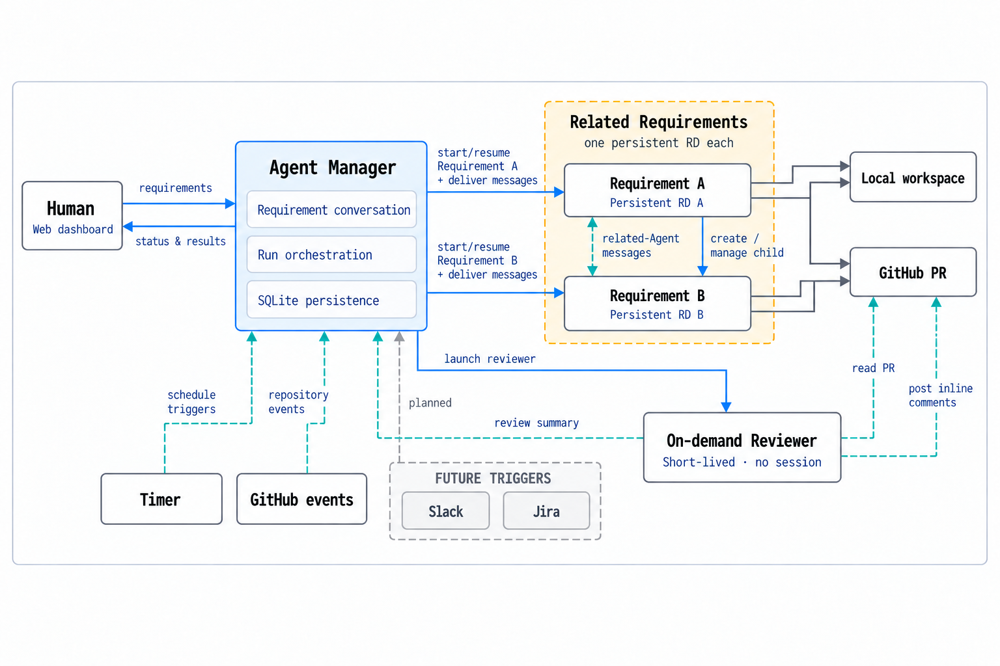

  

<h1 align="center">Code Factory</h1>

<strong>A tree-based collaboration platform for requirements, coding-agent teams, and humans.</strong>

  
  
  <a href="packages/agent-manager/package.json">=22.19.0" /></a>
  

https://github.com/user-attachments/assets/80896c78-c804-4c3d-98df-75ccc68031f3

Code Factory brings requirements, coding agents, and GitHub pull requests into one local dashboard. Organize work as a requirement tree and collaborate with **Codex**, **Claude Code**, or **Native Agent** through conversation.

Each requirement has its own persistent agent context. Agents can split work into child requirements and work in parallel, while humans steer the work, request reviews, and confirm completion.

## How It Works

  

## Quick Start

Requires **Node.js 22.19+**. See [Running Code Factory](docs/running-code-factory.md) for agent CLI and GitHub setup, or the [Native Agent guide](docs/native-agent.md) for API profile configuration.

~~~bash
cd /path/to/the/repository/to-manage
npx --package @luoyixin/code-factory code-factory-agent-manager start --daemon
~~~

Open [http://127.0.0.1:4310](http://127.0.0.1:4310), create a requirement, and select an agent to begin. The startup directory becomes the default workspace; the dashboard is bundled with Agent Manager.

Unsent conversation text and attachments return when you reopen a requirement or reload the dashboard in the same browser.

E2B sandbox creation prepares a remote directory; the Native Agent chooses and clones the task repository when needed. See the [Native Agent guide](docs/native-agent.md).

Headless agents inherit your filesystem, network, and command permissions. Run Code Factory in trusted repositories and limit dashboard access to trusted users.

## Documentation

- [Running Code Factory](docs/running-code-factory.md) — prerequisites, configuration, CLI options, and daemon operation.
- [Tailscale remote access](docs/tailscale.md) — access the dashboard from another device.
- [Architecture and domain model](docs/architecture.en.md) — requirement lifecycle, sessions, messaging, and review workflow.
- [Headless Agent Runner](docs/agent-runners.md) — Codex and Claude Code integration.
- [Native Agent guide](docs/native-agent.md) — API profiles, tools, and E2B sandboxes.
- [HTTP API reference](docs/agent-manager-api.md) and [event protocol](docs/protocol.md).
- [Development guide](docs/development.md) — source installation, builds, and checks.
- [Release guide](docs/releasing.md) and [roadmap](docs/roadmap.md).

## License

[Apache License 2.0](LICENSE).
