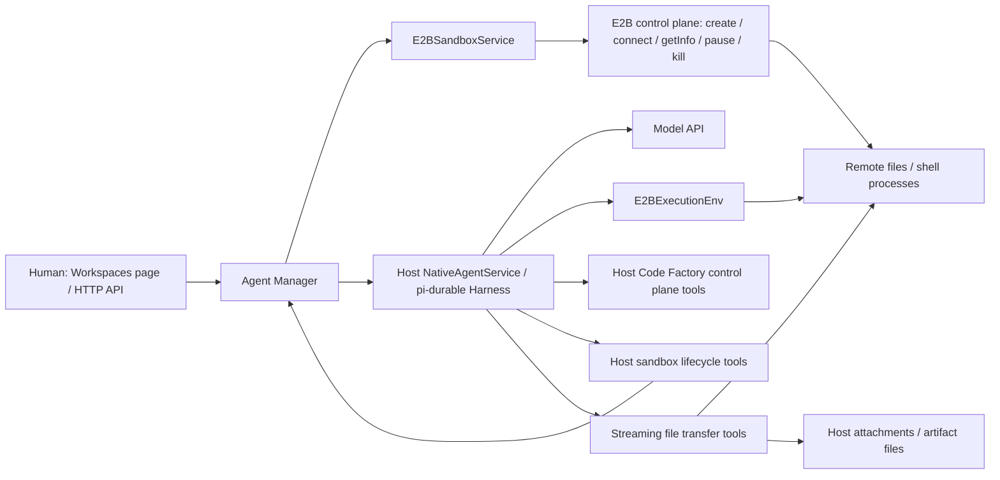
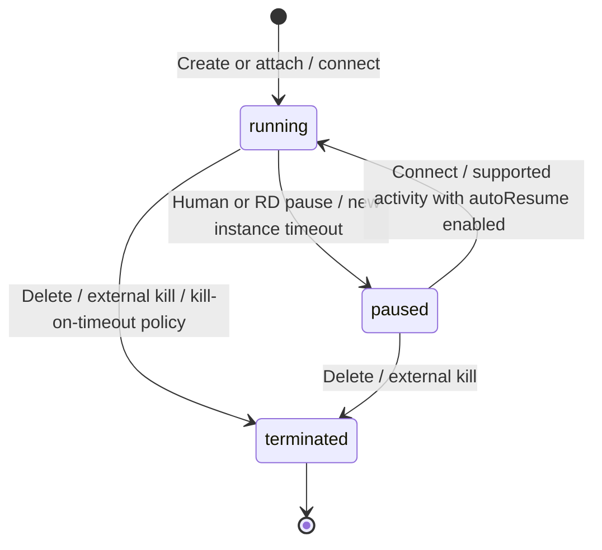

# E2B Sandbox Lifecycle and Readiness Audit

Audit date: 2026-10-25. Requirement: `req_4c884ffa-9cc1-4d79-aabb-a146e0f043c7`. Baseline: `fc5f9d0`, including PR #166's Native E2B lifecycle tools, file transfers, and lazy connections. Agent Manager version: `0.2.8`; E2B SDK version in the lockfile: `2.52.0`.

Code Factory supports Native Agent remote file operations, commands, and reviews in a manually prepared environment. RD Agents can also pause/resume their sandbox and transfer attachments and artifacts. Reliable long tasks and unattended operation still need runtime lease renewal, failure recovery, and resource cleanup. Automatic attachment staging and browser artifact delivery are usability improvements. This document records current behavior and recommendations without changing runtime policy; P0/P1/P2 indicate the recommended implementation order.

## 1. Who controls the sandbox



- **Humans and Manager initiate workspace operations.** The Workspaces page and `/api/sandboxes` endpoints create, attach, inspect, pause, resume, and delete sandboxes. There is no corresponding `code-factory-cli sandbox` command.
- **Native E2B RD Agents can control their selected sandbox.** `sandbox_status`, `sandbox_pause`, and `sandbox_resume` call Manager for the current Requirement's sandbox; they do not accept another sandbox ID. An Agent may pause the sandbox during its own RD Run and continue model/control plane work on the host. Another active RD Run or any active Reviewer sharing the sandbox prevents the pause. Reviewers do not receive these tools.
- **NativeAgentService connects lazily for remote operations.** The Harness `env` factory returns a `DeferredExecutionEnv`; the first remote file or command operation calls `connect`. Model-only replies, status checks, and host control plane tools do not wake the sandbox. Manager also connects when delivering an oversized Requirement/message body as a remote temporary file. Cleanup skips paused or unreachable instances to avoid waking them again.
- **The E2B control plane applies each instance's timeout and resume policy.** Manager explicitly requests pause-on-timeout and auto-resume for new instances; attached instances keep their existing policy, which may kill them on timeout. Manager has no sandbox heartbeat, Run lease renewal service, or scheduled resource collector. The first remote operation's `connect` may extend the deadline; it does not keep a long command alive throughout execution. External E2B consoles and other clients holding credentials can also operate the sandbox.
- **The model, Harness, and conversation database stay on the host.** E2B handles file and shell operations routed through `ExecutionEnv`, including GitHub commands through remote `bash`. Requirement/PR/Timer control plane tools stay on the host. `sandbox_upload` and `sandbox_download` can access host files with the launching user's permissions. After the host shuts down, remote resources remain subject to E2B's own policies.

Implementation entry points: [E2B service and execution environment](../packages/agent-manager/src/runtime/e2b-execution-env.ts), [NativeAgentService](../packages/agent-manager/src/runtime/native-agent.ts), [Manager lifecycle methods](../packages/agent-manager/src/core/agent-manager.ts), and [HTTP routes](../packages/agent-manager/src/http/server.ts). See the [API reference](agent-manager-api.md#get-apisandboxes) for endpoint fields.

## 2. When sandboxes start, pause, and terminate

| Scenario | Current behavior | Controller and restrictions |
| --- | --- | --- |
| Create an E2B workspace without an existing ID | Immediately calls `create`, then `getInfo`, and saves the sandbox record and credential reference; the default template is `base` | A human initiates the operation and Manager calls the SDK; it starts even before a Requirement exists |
| Supply an existing sandbox ID | Calls `connect`, then `getInfo`; a paused instance resumes | Manager attaches the external instance without resetting its lifecycle policy |
| Create/select a Requirement | Binds `sandboxId` and checks the provider and cached status | E2B requires Native Agent; selection itself does not create another sandbox or prepare a repository |
| RD / Native Reviewer performs remote operations | The lazy environment calls `connect` on first use and discovers the default directory with `pwd` | A paused instance resumes; model-only/host tools do not connect. Uploading oversized input also connects |
| RD calls `sandbox_pause` / `sandbox_resume` | Manager pauses/connects and refreshes status; resume resets the cached execution environment | Pause permits the caller's own RD Run but rejects other active RD Runs and every active Reviewer. There is no Agent tool for sandbox deletion |
| RD uploads/downloads a file | `sandbox_upload` / `sandbox_download` stream files between host and remote storage, requiring a remote connection | Host attachment paths are supported. A failed upload may leave a partial remote file; a download is published atomically after completion and preserves existing host files by default |
| Health check / RD calls `sandbox_status` | Calls `getInfo`, updating `status` and `checkedAt` | Does not resume the instance. This checks control plane state, not Git, toolchain, or model readiness. Cancelled checks preserve the existing record |
| Change domain / API key | Verifies through `connect` + `getInfo` before saving; key rotation removes the old credential reference | Connection changes are rejected during an active RD or Reviewer Run. Verification may resume the instance. Renaming alone does not connect |
| Human clicks Pause | Checks active RD/Reviewer usage, then calls `pause` and refreshes health | Conflicts with an active Run; idle Requirements may remain bound |
| Human clicks Resume | Calls `connect` and refreshes health | No active-Run restriction; cannot restore a destroyed instance |
| An instance created by Code Factory reaches its provider timeout | Configured to pause through `onTimeout: 'pause'` | Expected behavior when the provider honors the requested policy; does not pass through Manager's active-Run checks |
| An attached instance reaches its provider timeout | Follows its existing policy: pause or kill | Attachment does not convert kill-on-timeout to pause-on-timeout; a killed instance cannot be resumed |
| Run succeeds, fails, times out, or receives Stop Run | Finishes/aborts the Agent Run; **does not automatically pause or kill the sandbox** | Stop Run aborts the conversation. The output spill path attempts to kill its remote command handle; that does not destroy the sandbox |
| Requirement completes/is cancelled, or retention cleanup runs | Updates or deletes Requirement data; **does not collect the sandbox** | Retained completed Requirements still prevent workspace deletion; removing references does not automatically kill it |
| Manager shuts down normally or crashes | Normal shutdown closes host conversations, Store, and credential storage without sandbox cleanup | Manager shutdown does not imply the remote resource has stopped or stopped accruing charges |
| Delete a workspace | Checks active Runs and all Requirement bindings, calls `kill`, then removes the local record and credential | Any bound Requirement, regardless of status, prevents deletion. Externally attached instances are also killed; there is no detach-only operation |
| Initialization/persistence fails after creation | Once an ID is available, Manager attempts to kill a newly created instance, leaves attached instances alive, and removes the new credential reference | Rollback is best effort; kill errors are ignored. Lost create responses and process crashes have no durable compensation workflow |

The normal lifecycle can be simplified to:



`unreachable` and `unknown` are local observation states rather than additional remote lifecycle states. A not-found result from `getInfo` is recorded as `terminated`; other lookup errors become `unreachable`. E2B's default pause preserves filesystem and memory state, while kill prevents restoration of that instance; see [E2B persistence](https://docs.e2b.dev/sandbox/persistence). Behavior at a custom domain still needs verification.

## 3. The 10-minute setting is not an activity-based idle timeout

E2B's documented default is **kill on timeout**, not pause. Code Factory explicitly overrides that default when it creates a new instance; attaching an existing instance does not change its policy. See [E2B auto-pause configuration](https://docs.e2b.dev/sandbox/persistence#auto-pause).

| Creation path | Timeout action |
| --- | --- |
| SDK creation without an explicit lifecycle policy | Provider default: `kill` |
| New instance created by Code Factory | Explicitly requests `pause`, with auto-resume enabled |
| Existing instance attached to Code Factory | Existing policy, which may be `kill` or `pause` |

Code Factory creates new instances with these fixed options:

```ts
{ timeoutMs: 600_000, lifecycle: { onTimeout: 'pause', autoResume: true } }
```

The locked SDK maps this request to `autoPause: true` in the provider API. The deterministic service test checks the options passed to the SDK; it does not wait for a real sandbox to expire. No real target-domain timeout experiment was run, so the configured policy must not be presented as an observed cloud result. To diagnose a specific instance, inspect `lifecycle.onTimeout` in the provider SDK's `getInfo` result. Manager does not persist that policy in its sandbox record; cached status and check time do not establish it.

This is **E2B's expiry policy**. The repository neither tracks the last business activity to reset a 10-minute countdown nor calls `Sandbox.setTimeout`. Commands and file reads/writes do not automatically extend the expiry of a running instance. After a pause, the next supported operation can trigger automatic resume; see [E2B auto-resume](https://docs.e2b.dev/sandbox/auto-resume). A continuous build, test, or service can therefore encounter a pause and connection interruption mid-operation. Resume does not guarantee that the current command request continues seamlessly.

`connect` receives no `timeoutMs`, leaving its effective deadline to SDK/service defaults. Current official semantics extend expiry to the later of the existing deadline and now plus the connection timeout, which defaults to five minutes; see [E2B connection timeout](https://docs.e2b.dev/sandbox/persistence). Connections for first remote use or explicit resume may indirectly extend the deadline. However, the lazy environment caches the connection instead of reconnecting for every model preparation or tool call, and output polling during a long command provides no such keepalive. A fixed 10-minute runtime after every resume is not guaranteed. Attached instances inherit their existing expiry/auto-resume policy, which may even kill them on timeout.

There are separate Agent and command timeouts: RD defaults to 60 minutes without Harness activity, Reviewer has a total elapsed-time limit of at most 30 minutes, and shell commands may have their own timeout. These timers do not renew the sandbox lease. In particular, Manager's protection against human Pause during an active Run cannot prevent the provider from pausing the instance on expiry.

### When `setTimeout` and `connect` are called

Code Factory does not call the sandbox SDK's `setTimeout` method (`set_timeout` in Python), either at Run startup or on a timer. The initial `timeoutMs` passed to `create` is a creation option, not a later renewal call. `connect` is triggered by operations rather than a periodic schedule:

| Trigger | SDK call timing |
| --- | --- |
| Create a workspace without an existing sandbox ID | Calls `create`, not the Manager's `connect` wrapper |
| Attach an existing sandbox ID | Calls `connect` before reading and saving its status |
| Change the domain or submit an API key | Calls `connect` to verify the connection settings before saving; renaming or editing only environment variables does not connect |
| Human Resume or Native RD `sandbox_resume` | Calls `connect` immediately; the Native tool also clears the cached handle and resets the deferred environment |
| Native RD or Reviewer Run first accesses remote files or commands | Calls `connect` lazily, including on first upload/download, and caches the handle for that Run |
| Oversized input needs a remote temporary file | Manager separately calls `connect` and uploads the payload before invoking the Native runner |

Within a Run, later model turns and remote tools reuse the cached handle. Run cleanup removes it, so a later Run connects again on its first remote operation. A successful Native `sandbox_resume` invalidates the handle, so the next remote operation connects again even within the same Run. Failed or cancelled connection initialization also removes its cached promise, allowing a subsequent attempt to reconnect. These calls do not require the sandbox to be paused; they can also connect to a running instance.

Ordinary Run startup, model-only replies, health/status queries, host control-plane tools, and long-command output polling do not themselves call `connect` or renew a lease. A Run may therefore contain several model/tool rounds after its last connection without extending the provider deadline. See [Manager call sites](../packages/agent-manager/src/core/agent-manager.ts) and [Native handle caching and cleanup](../packages/agent-manager/src/runtime/native-agent.ts). The call sites were also checked against `1ef8d4a`; this clarification does not revise the earlier capability-audit baseline.

## 4. Available capabilities and boundaries

| Capability | Implemented | Boundary |
| --- | --- | --- |
| Workspace management | Create/attach; reject duplicate domain + provider ID; rename; verify before rotating key/domain; health, pause, resume, delete | Cannot change provider ID or template on the existing record; no detach-only operation |
| Credential persistence | Separate `e2b-credentials.sqlite` with mode `0600`; application DB stores opaque references; API does not return the key; legacy environment-variable references remain supported | Plaintext SQLite protected by file permissions; backups/migrations need both the application and credential databases |
| Native RD / Review | Remote file reads/writes, edits, and commands; exit codes, streaming output, large-output spill files, interruption; Reviewer shares the workspace with a separate conversation | Codex / Claude Code RD do not support E2B. Reviewer has only read/bash, without lifecycle or transfer tools; bash can still write files |
| Agent lifecycle control | E2B RD tools `sandbox_status` / `sandbox_pause` / `sandbox_resume`; host model work continues after self-pause; host-only operations leave it asleep | Pause permits its own Run but is blocked by other RD/Reviewer usage. Remote work in the same Run should finish before pausing. Local RD and Reviewer do not receive this extension |
| Request cancellation | Remote tools combine Run interruption and Harness cancellation, covering lazy connect, pwd, transfers, and lifecycle requests; cancelled initialization can be retried | Local cancellation cannot undo a pause/resume already accepted by the provider; check status afterward |
| Repositories and directories | New records have null `cwd` / `repositoryUrl`; Agents inspect, reuse, or clone repositories as needed; legacy record behavior remains | Commands are independent; use explicit `cd` or absolute paths. Successful creation does not establish Git, gh, dependency, or authentication readiness |
| GitHub integration | `gh pr` through `bash` runs remotely; PR registration/metadata lookup and reconciliation use the host control plane | New sandboxes do not receive host `GH_TOKEN` / `GITHUB_TOKEN`; configure remote authentication. Legacy forwarding remains only when the stored repository host is exactly `github.com` |
| Sharing and persistent conversations | Multiple Native Requirements can reuse a sandbox; each conversation persists on the host; `ExecutionEnv.id` identifies the filesystem by domain + provider ID | Files, processes, and remote credentials are shared. No automatic independent Git worktree creation or repository-wide write mutex |
| Status display | Persists the latest `status` and `checkedAt`; the page offers Check health | Lists use cached observations. Run connections and provider auto-pause/resume do not refresh the record. Workspaces Running/Idle columns depend on whether a Requirement is `doing`, independently of cloud state |
| Input and artifacts | `sandbox_upload` sends host attachments and `sandbox_download` retrieves results; supports binary/empty files and returns paths and byte counts. Oversized text has a separate upload path; large command output retains a remote spill path | Ordinary attachments are not automatically uploaded or remapped; the Agent invokes tools as needed. Downloads are host files without conversation attachment/browser download links. Temporary remote input files may remain when cleanup skips paused/unreachable instances |

## 5. Recommendations for reliable operation

P0 identifies a blocker for the target workload, rather than a claim that all short tasks are unusable. These are product integration gaps; an SDK API alone does not establish that Code Factory has integrated the capability.

| Priority | Gap and impact | Recommended capability and acceptance criteria |
| --- | --- | --- |
| P0: long tasks | Fixed expiry and no active-Run lease renewal can interrupt long commands; attached-instance policies are unknown | Aggregate RD/Reviewer leases by sandbox, renew within bounds while used, and pause according to configuration after the last user exits. Expose effective lifecycle and expiry. Test commands spanning the expiry point, two shared Runs, and Manager shutdown; handle provider runtime limits |
| P1: concurrent operations | `ensureSandboxIdle` checks once before the SDK call, without a lock spanning the wait. A new Run may start afterward, and pause/resume/update operations may interleave. Self-pause permits the caller's Run, so finishing its remote work first still relies on instructions | Serialize lifecycle operations per sandbox and make Run admission atomic with pause/connection changes/delete. Verify interleavings with a delayed fake SDK. Shared repositories also need explicit worktree/directory allocation rules |
| P1: failure recovery | Connection failure does not update cached state; generic provider errors are grouped; external kill leads to failure without a recovery/migration workflow | Reconcile status without waking instances; distinguish safe missing/auth/quota/network error categories; provide controlled retries and human recovery. Explicitly create a replacement workspace and preserve unconsumed input after termination; do not promise recovery of unbacked-up files from a killed instance |
| P1: ownership and cleanup | Records do not distinguish creation from attachment; delete kills both. Completion does not directly release references, and there is no orphan compensation or idle resource governance | Distinguish Manager-owned from externally attached resources and provide detach-only versus explicit destruction. Check all references, preserve artifacts, configure retention, and make collection/compensation idempotent. Do not destroy referenced or externally owned instances by default |
| P1: readiness and real-provider validation | Provisioning establishes SDK connectivity, not clone/push/Review/dependency readiness; existing tests mostly use fake providers/models | Offer independent, task-driven readiness checks and template/authentication guidance. Keep provisioning separate from repository preparation, so an empty sandbox need not contain a checkout. Run real-domain smoke tests for file operations, pause/resume, long commands, clone/push/PR/Review, restart, and cleanup |
| P2: attachments and delivery | Agents can transfer files, but there is no automatic staging/path mapping and users cannot retrieve downloaded results directly through the browser | Reuse streaming transfers for idempotent staging and controlled conversation artifact downloads. Preserve cancellation and no-clobber behavior; host-only work must not wake the remote environment. Basic file transfer is already available |
| P2: operations experience | No resource/cost view, batch governance, durable background command handles, or preview interface | Add CPU/memory/expiry/reference/cost observation, background command start/logs/wait/kill, and port previews as needed. Design access control and credential scope for the deployment. Isolating the entire Agent is a separate architecture question |

The following child Requirements were registered through `code-factory-cli requirement propose`. All remain **TODO / idle**, with implementation not started:

| Suggested order | Follow-up | ID |
| --- | --- | --- |
| P0 | E2B runtime leases and lifecycle concurrency protection | `req_7e4a7a22-3984-4e06-a2ea-50f2fd1f8d9c` |
| P1 | E2B state recovery, resource ownership, and safe cleanup | `req_cb849547-3be8-4787-8736-0de6599f72af` |
| P1 | E2B readiness checks and real end-to-end validation | `req_27e3afc1-687e-446e-9670-3c38a7ccc613` |
| P2 | E2B automatic attachment staging and artifact downloads | `req_013cfef2-cb7c-4917-a825-473a0d72f282` |

Each follow-up includes context and acceptance criteria. Long-command readiness validation depends on runtime leases. After PR #166 merged during the audit, the original attachment-transfer blocker proposal, `req_ccf1a02d-227c-4e51-8628-04429c9547d0`, was cancelled through `requirement action --delete` and replaced by the P2 usability proposal above to avoid duplicating existing capabilities. This Requirement delivers the audit without introducing these runtime changes.

## 6. Using the current implementation

1. Prepare the target domain, API key, and an appropriate template. For GitHub work, configure remote git, gh, authentication, and the task toolchain. Also ensure host gh works for PR registration and reconciliation.
2. Create or attach the workspace and run Check health. Verify an attached instance's existing lifecycle; new instances currently start with a 10-minute initial timeout.
3. Use a Native Agent Requirement and specify repository URLs and working directories. Agree on separate worktrees/directories for concurrent work in one sandbox. The Agent uses `sandbox_upload` for host attachment paths, then remote read/bash; use `sandbox_download` for results and report the host path. Direct browser downloads remain a follow-up.
4. After remote work finishes, the Agent can call `sandbox_pause` and continue model replies, status checks, or host tools while it stays paused. Use `sandbox_resume`, or auto-resume through remote I/O when enabled, for more remote work. Humans can Pause when no RD/Reviewer Run is active. Preserve artifacts before destruction and remove all Requirement references before deleting. Delete also destroys externally attached instances, so coordinate cleanup with their owner.
5. For commands longer than the timeout, set a sufficient deadline through controlled E2B operations or wait for runtime lease support. Code Factory's UI/API currently has no timeout setting.

## 7. Validation and evidence scope

The following checks were run for the audit:

```sh
cd packages/agent-manager
npm ci --no-audit --no-fund
npx tsx --test test/e2b-execution-env.test.ts test/e2b-sandbox.test.ts test/native-agent.test.ts test/e2b-file-transfer.test.ts test/deferred-execution-env.test.ts
```

Result: **54 passed, 0 failed**. Coverage includes SDK options and error redaction, remote file/command adaptation, default directories, output spill and interruption, API lifecycle, credential rotation/restart, shared selection, Native Reviewer, oversized text uploads, persistent conversations/Steering, Native lifecycle tools, lazy connections, status checks without wake-up, shared RD/Reviewer pause protection, streaming binary/empty-file transfer, cancellation, and download no-clobber behavior.

A temporary Node script with an in-memory Store, fake E2B, and a controlled Native runner verified four groups of public outcomes: lists keep stale state until explicit health, and health does not connect; ordinary attachments still use host paths without automatic Manager upload, leaving transfer to Native RD's `sandbox_upload`; an active RD blocks dashboard/API pause/delete, and remaining references still block deletion after the Run; successful Run completion and Manager close do not call sandbox pause/kill unless lifecycle tools explicitly do so. The script changed no runtime code and made no real cloud connections.

Findings about lifecycle operation races, provider expiry, and real network recovery come from code paths or official semantics. These tests do not establish real E2B end-to-end reliability. No real E2B credentials, billable resources, or long-duration experiments were used. No application build was run locally for this documentation-only audit.

Use these entry points to revisit the evidence:

| Finding | Implementation/test entry point |
| --- | --- |
| Create, attach, rollback, status, guards, delete | [agent-manager.ts](../packages/agent-manager/src/core/agent-manager.ts): `createE2BSandbox`, `updateSandbox`, `checkSandboxHealth`, `ensureSandboxIdle`, `deleteSandbox` |
| Expiry options, SDK wrapper, files/commands, interruption | [e2b-execution-env.ts](../packages/agent-manager/src/runtime/e2b-execution-env.ts): `E2BSandboxService`, `E2BExecutionEnv` |
| Model/environment location, Run completion, shutdown | [native-agent.ts](../packages/agent-manager/src/runtime/native-agent.ts): Harness `env`, `run`, `close`; Manager `startRdRun`, `close` |
| Separate attachment and oversized-text paths | [agent-manager.ts](../packages/agent-manager/src/core/agent-manager.ts): `uploadMessageAttachment`, `formatRdMessages`, `startRdRun`, `runWithRemotePromptPayloads` |
| Lazy connections and file transfer | [deferred-execution-env.ts](../packages/agent-manager/src/runtime/deferred-execution-env.ts), [e2b-file-transfer.ts](../packages/agent-manager/src/runtime/e2b-file-transfer.ts); Native `sandboxControl` and `transfer` tools; Manager `controlNativeSandbox` |
| Credentials and retention | [e2b-credentials.ts](../packages/agent-manager/src/runtime/e2b-credentials.ts), [sqlite-store.ts](../packages/agent-manager/src/storage/sqlite-store.ts): `purgeExpiredRequirements` |
| Page actions and status grouping | [page.tsx](../apps/web/app/page.tsx): `changeSandbox`, `workspaceRequirements`, Workspaces details and cards |
| Deterministic tests | [e2b-sandbox.test.ts](../packages/agent-manager/test/e2b-sandbox.test.ts), [e2b-execution-env.test.ts](../packages/agent-manager/test/e2b-execution-env.test.ts), [native-agent.test.ts](../packages/agent-manager/test/native-agent.test.ts) |
