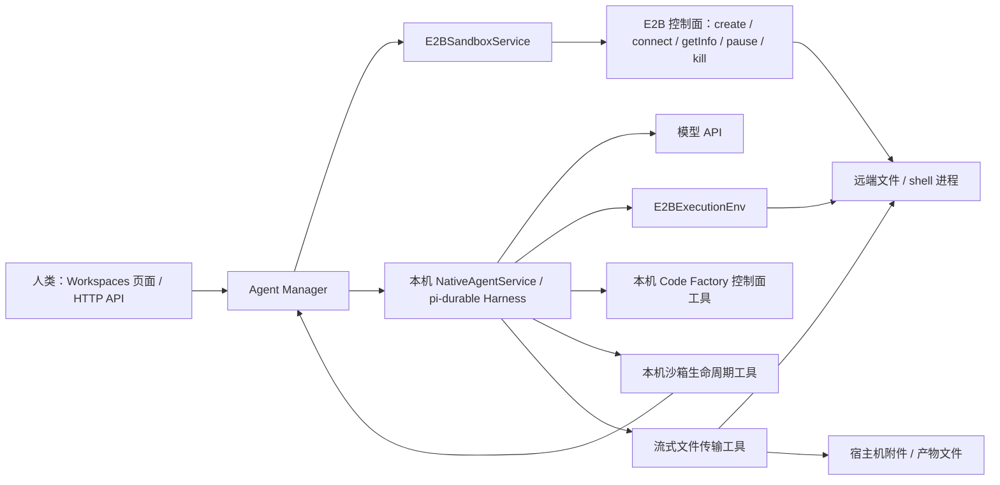
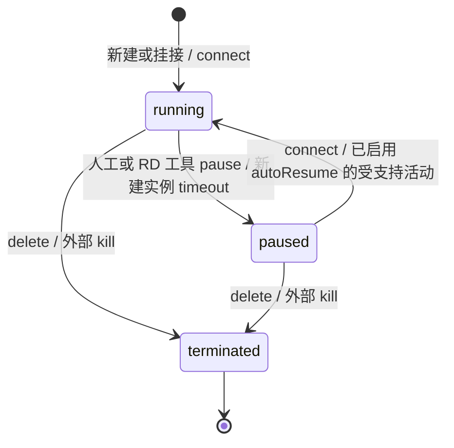

# E2B 沙箱生命周期与可用性梳理

审计日期：2026-10-25。需求：`req_4c884ffa-9cc1-4d79-aabb-a146e0f043c7`。基线：`fc5f9d0`（已含 PR #166 的 Native E2B 生命周期/文件传输工具及惰性连接），Agent Manager `0.2.8`，锁文件中的 E2B SDK `2.52.0`。

当前已经具备人工配置环境下使用 Native Agent 远程读写、执行命令、Review，以及由 RD Agent 控制暂停/恢复和传输附件/产物的基础能力。要支持可靠的长任务和无人值守运行，还需要补齐运行期续租、故障恢复及资源回收；附件自动暂存和浏览器产物交付属于体验增强。本文只梳理现状和建议，不修改运行时策略；下文的 P0/P1/P2 是建议实施顺序。

## 1. 沙箱由谁控制



- **人类和 Manager 发起工作区操作**：页面及 `/api/sandboxes` 系列接口负责创建、挂接、检查、暂停、恢复和删除；没有对应的 `code-factory-cli sandbox` 命令。
- **Native E2B RD Agent 也能控制所选沙箱**：`sandbox_status`、`sandbox_pause`、`sandbox_resume` 通过 Manager 回调操作当前 Requirement 的沙箱，不接收其他沙箱 ID。Agent 可在自己的 RD Run 中主动暂停，之后继续本机模型/控制面工作；其他 RD 或任意 Reviewer 正使用同一沙箱时不允许暂停。Reviewer 没有这些工具。
- **NativeAgentService 按远端操作惰性连接**：Harness `env` 返回 `DeferredExecutionEnv`；首次远端文件/命令操作才 `connect`。纯模型回复、状态检查和本机控制面工具不唤醒沙箱。大段需求/消息正文落远端临时文件时，Manager 也会先连接沙箱；结束清理会跳过已暂停/不可达实例，避免再次唤醒。
- **E2B 控制面执行到期暂停及自动恢复**：Manager 设置新实例的策略，但没有自己的沙箱心跳、Run 租约续期器或定时回收器。首次远端操作的 `connect` 可能延长期限；这不提供长命令运行期间的保活。沙箱也可以被外部 E2B 控制台或持有凭据的其他客户端操作。
- **模型、Harness、会话数据库在宿主机**：E2B 承载经 `ExecutionEnv` 路由的文件和 shell 操作，GitHub 命令用远端 `bash`。Requirement/PR/Timer 控制面工具留在宿主机；`sandbox_upload` / `sandbox_download` 能按宿主机用户权限读写本机文件。宿主机停机后，远端资源仍由 E2B 自己的策略控制。

实现入口：[E2B 服务与执行环境](../packages/agent-manager/src/runtime/e2b-execution-env.ts)、[NativeAgentService](../packages/agent-manager/src/runtime/native-agent.ts)、[Manager 生命周期方法](../packages/agent-manager/src/core/agent-manager.ts)、[HTTP 路由](../packages/agent-manager/src/http/server.ts)。接口字段见 [API 文档](agent-manager-api.md#get-apisandboxes)。

## 2. 什么时候启动、暂停和销毁

| 场景 | 当前实现 | 控制者及限制 |
| --- | --- | --- |
| 新建 E2B 工作区，不填现有 ID | 立即 `create`，然后 `getInfo`，保存沙箱记录和凭据引用；默认模板 `base` | 人类发起，Manager 调 SDK；还没有 Requirement 也会启动 |
| 填入现有沙箱 ID | `connect` 后 `getInfo`；暂停实例会恢复 | Manager 挂接外部实例；不重设它的 lifecycle 策略 |
| 创建/选择 Requirement | 绑定 `sandboxId`，检查 provider 和缓存状态 | 只支持 Native Agent；选择本身不创建另一个沙箱，不准备仓库 |
| RD / Native Reviewer 执行远端操作 | 惰性环境首次使用时 `connect`，用 `pwd` 发现默认目录 | 暂停实例会恢复；纯模型/本机工具不会连接。大段输入上传也会触发连接 |
| RD 调用 `sandbox_pause` / `sandbox_resume` | 通过 Manager 暂停/连接并刷新状态；恢复后重置缓存执行环境 | Pause 允许调用者自己的 RD Run，拒绝其他活跃 RD 和任意 Reviewer。当前没有 Agent 删除沙箱工具 |
| RD 上传/下载文件 | `sandbox_upload` / `sandbox_download` 在宿主机与远端间流式传输；需要连接远端 | 支持宿主机附件路径。上传失败可能留远端半文件；下载完整后原子发布，默认不覆盖本机已有文件 |
| 检查健康 / RD 调用 `sandbox_status` | `getInfo`，更新 `status` 和 `checkedAt` | 不恢复实例；这是控制面状态查询，未检查 Git、工具链或模型可用性。取消的检查保留原记录 |
| 修改 domain / API key | `connect` + `getInfo` 验证成功后保存；换 key 后删除旧引用 | 有 RD 或 Reviewer Run 时拒绝更改连接；验证操作可能恢复实例。只改名称不连接 |
| 点击 Pause | 先检查是否有使用该沙箱的活跃 RD / Reviewer，再 `pause` + 健康检查 | 有活跃 Run 返回冲突；无需解除闲置 Requirement 的绑定 |
| 点击 Resume | `connect` + 健康检查 | 没有活跃 Run 限制；不能恢复已经被销毁的实例 |
| 新建实例达到 provider timeout | E2B 执行 `onTimeout: 'pause'` | 不经过 Manager 的活跃 Run 检查 |
| Run 成功、失败、超时、Stop Run | 结束/中止 Agent Run；**没有沙箱级 `pause` / `kill`** | Stop Run 中止会话；输出 spill 路径会尝试 kill 对应远端命令句柄，不等于销毁沙箱 |
| Requirement 完成/取消、保留期清理 | 更新或删除 Requirement 数据；**不回收沙箱** | 留存的已完成 Requirement 仍会阻止删除其工作区；清理引用后也不自动 kill |
| Manager 正常关闭/崩溃 | 正常关闭本机会话、Store 和凭据库；没有沙箱级清理 | 不能将 Manager 停机视为云端停止或停止计费 |
| 删除工作区 | 检查活跃 Run 和所有 Requirement 绑定，再 `kill`，删除本地记录及凭据 | 任意状态的 Requirement 仍绑定时拒绝。挂接的外部实例也会被 kill；没有“仅解绑”操作 |
| 创建后初始化/保存失败 | 已拿到实例 ID 时，新建实例尝试 kill，挂接实例不 kill；清理新凭据引用 | 尽力回滚；kill 失败被忽略。create 响应丢失、进程崩溃等窗口没有持久补偿 |

正常生命周期可以简化为：



`unreachable` 和 `unknown` 是本地观测状态，不代表两种额外的远端生命周期。`getInfo` 返回“找不到”时记录为 `terminated`，其他查询错误记录为 `unreachable`。E2B 默认暂停保留文件及内存状态，kill 后无法恢复原实例，见 [E2B persistence](https://docs.e2b.dev/sandbox/persistence)。实际自定义 domain 的服务行为仍需验证。

## 3. “10 分钟”并非按任务活动计算的空闲时间

新建实例固定使用：

```ts
{ timeoutMs: 600_000, lifecycle: { onTimeout: 'pause', autoResume: true } }
```

这是 **E2B 的到期时间策略**。仓库没有记录最后一次业务活动并据此重置 10 分钟倒计时，也没有调用 `Sandbox.setTimeout`。运行命令、读写文件不会自动延后正在运行实例的到期时间；到期后下一次受支持的活动可以触发自动恢复，见 [E2B auto-resume](https://docs.e2b.dev/sandbox/auto-resume)。因此，持续运行的编译、测试或服务仍可能遇到中途暂停和连接中断；恢复不等于当前命令请求必然无缝继续。

`connect` 没有传 `timeoutMs`，其有效期限交给 SDK/服务默认值处理。官方当前语义是将到期时间延长到“现有期限”和“当前时间加连接 timeout”中较晚的一个，默认连接 timeout 为 5 分钟，见 [E2B connect timeout](https://docs.e2b.dev/sandbox/persistence)。首次远端操作、显式 resume 等连接可能间接延长期限，但惰性环境缓存连接，不会在每次模型准备或工具调用时重新 connect；一次长命令执行期间的输出轮询也没有这种保活。不能承诺每次恢复后都固定运行 10 分钟。挂接实例则完全继承其原有到期/自动恢复策略，甚至可能是到期 kill。

另有两个独立的超时：RD 默认在 60 分钟无 Harness 活动后超时，Reviewer 的总耗时最多 30 分钟；shell 命令还可以有自身 timeout。这些超时器不会替沙箱续租。尤其是 Run 仍活跃时，Manager 对人工 Pause 的保护不会阻止 provider 自己到期暂停。

## 4. 当前已经具备的能力与边界

| 能力 | 已实现 | 使用边界 |
| --- | --- | --- |
| 工作区管理 | 新建/挂接、同 domain + provider ID 防重复、改名、验证连接后换 key/domain、健康检查、暂停/恢复/删除 | 不支持在原记录上换 provider ID 或模板；无仅解绑功能 |
| 凭据持久化 | 独立 `e2b-credentials.sqlite`，文件权限 `0600`；应用库保存不透明引用，API 不回显 key；保留旧环境变量引用 | 是受文件权限保护的 SQLite 明文存储；备份/迁移须同时保留应用库及凭据库 |
| Native RD / Review | 远程文件读写、编辑和命令；退出码、输出流、大输出落盘、中断处理；Reviewer 使用同一工作区及独立会话 | Codex / Claude Code RD 不支持 E2B；Reviewer 仅有 read/bash，无生命周期和文件传输工具，bash 本身仍可写文件 |
| Agent 生命周期控制 | E2B RD 专用 `sandbox_status` / `sandbox_pause` / `sandbox_resume`；自暂停后本机模型继续；纯本机操作不唤醒沙箱 | pause 允许自己的 Run，其他 RD/Reviewer 阻止；同一 Run 应先结束远端操作再暂停。Local RD 和 Reviewer 都不会获得该扩展 |
| 请求取消 | 远端工具合并 Run 中断与 Harness 取消信号，覆盖惰性连接、pwd、传输和生命周期请求；取消初始化后可重试 | provider 已接受的 pause/resume 不能靠本地取消撤销，需随后检查状态 |
| 仓库与目录 | 新记录 `cwd` / `repositoryUrl` 为 null；Agent 可按任务检查、复用或克隆仓库；保留旧记录语义 | 每次命令独立，应显式 `cd` 或用绝对路径。创建成功不代表 git、gh、依赖或认证已经就绪 |
| GitHub 集成 | `bash` 中的 `gh pr` 在远端运行；PR 注册/元数据读取和 reconciler 使用宿主机控制面 | 新沙箱不转发宿主机 `GH_TOKEN` / `GITHUB_TOKEN`，需配置远端认证。旧记录仅在保存的仓库 host 恰为 `github.com` 时保留转发兼容 |
| 共享与持久会话 | 多个 Native Requirement 可复用一个沙箱；各自会话持久化在宿主机，`ExecutionEnv.id` 按 domain + provider ID 标识文件系统 | 共享文件、进程和远端凭据；不会自动创建独立 Git worktree，也没有仓库级写入互斥 |
| 状态展示 | 保存上次 `status` 和 `checkedAt`，页面提供 Check health | 列表读取缓存，Run 的连接和 provider 自动暂停/恢复不刷新记录；Workspaces 的 Running/Idle 列按 Requirement 是否 `doing` 分组，与云端状态无关 |
| 输入/产物 | `sandbox_upload` 可上传宿主机附件，`sandbox_download` 可下载结果；支持二进制和空文件，返回路径和字节数。超长正文另有上传路径，命令大输出保留远端 spill 路径 | 普通附件尚不自动上传/重写路径，由 Agent 按需调用工具；下载结果是本机文件，尚不发布为会话附件/浏览器下载链接。远端正文临时文件在实例暂停/不可达时跳过清理，可能残留 |

## 5. 补齐到可靠可用的建议

P0 表示目标场景的阻断项，不表示所有短任务都不可运行。以下是产品层面的缺口，不能用 SDK 支持某个 API 代替 Code Factory 已完成集成的结论。

| 优先级 | 缺口及影响 | 建议能力与验收标准 |
| --- | --- | --- |
| P0：长任务 | 固定到期、无活跃 Run 续租，长命令可能中断；挂接实例策略未知 | 按沙箱聚合 RD/Reviewer 活跃租约，运行中有界续期，最后一个使用者退出后按配置暂停；展示实际 lifecycle 和到期时间。跨越到期点的长命令、两个共享 Run、Manager 停机均有测试；保留 provider 运行上限处理 |
| P1：操作并发 | `ensureSandboxIdle` 在 SDK 调用前检查一次，没有覆盖等待期间的锁；检查之后新 Run 可能启动，多次 pause/resume/update 也可能交错。RD 自暂停允许本 Run，要求先结束远端工作仍依赖指令 | 沙箱级串行生命周期操作，以及 Run 启动与暂停/换连接/删除之间的原子准入；用延迟 fake SDK 验证并发结果。共享仓库另需明确 worktree/目录分配规则 |
| P1：故障恢复 | 运行连接失败不更新缓存；一般 provider 错误被归并；外部 kill 后只有失败，没有恢复/迁移流程 | 不唤醒实例的状态对账、区分缺失/认证/配额/网络等安全错误类别、受控重试和人工恢复入口；终止后显式创建替代工作区并处理未消费输入，不能承诺找回被 kill 的未备份文件 |
| P1：所有权与回收 | 新建和挂接不记录所有权，删除都会 kill；完成需求不能直接释放引用；无孤儿补偿或闲置资源治理 | 区分 Manager 所有与外部挂接，提供只解绑与明确销毁；多 Requirement 引用检查、产物保全、可配置保留期、幂等回收/失败补偿；默认不销毁仍被引用或外部所有的实例 |
| P1：环境就绪与实测 | provisioning 成功仅说明 SDK 可连接，无法保证 clone/push/Review/依赖可用；现有测试主要是 fake provider/model | 独立、按任务需要触发的 readiness 检查和模板/认证操作指南；保持 provision 与仓库准备分离，不要求空沙箱必须有仓库。用真实目标 domain 完成读写、暂停恢复、长命令、clone/push/PR/Review、重启及清理 smoke |
| P2：附件和交付体验 | 文件传输已可由 Agent 调用，但无自动附件暂存/路径映射，下载结果不能直接从浏览器取回 | 复用流式传输实现幂等暂存和受控会话产物下载；保留取消及默认不覆盖行为，纯本机操作不唤醒远端。不得再把“缺少基础文件传输”列为阻断项 |
| P2：运维体验 | 无资源用量/费用视图、批量治理、持久后台命令句柄或预览入口 | 按需求补充 CPU/内存/到期/引用/成本观测、后台命令 start/logs/wait/kill 和端口预览；访问控制和凭据范围随部署方式设计。更强的全 Agent 隔离是独立架构议题 |

已通过 `code-factory-cli requirement propose` 登记以下子需求，均保持 **TODO / idle**，没有启动实现：

| 建议顺序 | 子需求 | ID |
| --- | --- | --- |
| P0 | E2B 运行期租约与生命周期并发保护 | `req_7e4a7a22-3984-4e06-a2ea-50f2fd1f8d9c` |
| P1 | E2B 状态恢复、资源所有权与安全回收 | `req_cb849547-3be8-4787-8736-0de6599f72af` |
| P1 | E2B 环境就绪检查与真实端到端验证 | `req_27e3afc1-687e-446e-9670-3c38a7ccc613` |
| P2 | E2B 附件自动暂存与产物下载交付 | `req_013cfef2-cb7c-4917-a825-473a0d72f282` |

各子需求含问题背景及验收条件，环境验证中的长命令检查依赖运行期租约能力。审计期间 PR #166 合入后，已通过 `requirement action --delete` 取消原附件传输阻断提案 `req_ccf1a02d-227c-4e51-8628-04429c9547d0`，以表中的 P2 体验增强提案替代，避免重复建设。本需求仅交付梳理，不在审计中引入这些行为变化。

## 6. 当前如何使用

1. 准备目标 domain、API key 和合适的模板。需要 GitHub 操作时，在远端配置 git、gh、认证和任务工具链，同时确保宿主机用于 PR 注册及对账的 gh 可用。
2. 创建或挂接工作区，执行 Check health。挂接前确认实例原有 lifecycle；新建时知道当前初始 timeout 为 10 分钟。
3. 使用 Native Agent Requirement，写明仓库地址和操作目录；同沙箱并行任务约定独立 worktree/目录。Agent 用 `sandbox_upload` 上传提示词中的本机附件，再用远端 read/bash；用 `sandbox_download` 下载结果并报告本机路径，浏览器直接下载尚待补齐。
4. Agent 结束远端工作后可调用 `sandbox_pause`，只继续模型回复、状态检查或本机工具时保持暂停；需要远端操作时用 `sandbox_resume` 或由 I/O 自动唤醒。人类也可在没有活跃 RD/Reviewer 时 Pause。销毁前保全产物，并在所有 Requirement 引用解除后删除；当前 Delete 同样销毁外部挂接实例，应由资源所有者明确安排回收。
5. 长于 timeout 的持续命令，先通过受控 E2B 运维途径设置足够期限，或等待运行期续租能力补齐；Code Factory 当前 UI/API 没有 timeout 配置入口。

## 7. 验证与证据范围

已执行：

```sh
cd packages/agent-manager
npm ci --no-audit --no-fund
npx tsx --test test/e2b-execution-env.test.ts test/e2b-sandbox.test.ts test/native-agent.test.ts test/e2b-file-transfer.test.ts test/deferred-execution-env.test.ts
```

结果：**54 项通过，0 失败**。覆盖 SDK 参数及错误脱敏、远端文件/命令适配、默认目录、大输出与中断、API 生命周期与凭据轮换/重启、共享选择、Native Reviewer、超长正文上传、原生会话/Steering，以及 Native 生命周期工具、惰性连接、状态查询不唤醒、共享 RD/Reviewer 暂停保护、流式二进制/空文件传输、取消与下载不覆盖。

另以临时 Node 脚本和内存 Store、fake E2B、可控 Native runner 验证了四组公开结果：列表在显式 health 前保持旧状态且 health 不调用 connect；普通附件路径仍指向宿主机、Manager 不自动上传（由 Native RD 的 `sandbox_upload` 按需传输）；活跃 RD 阻止 dashboard/API pause/delete 且 Run 结束后仍有绑定时不能 delete；未显式使用生命周期工具时，成功 Run 和 Manager close 都未调用沙箱 pause/kill。脚本没有修改运行时代码，也没有连接真实云端。

生命周期操作竞争、provider 到期和真实网络恢复的结论来自代码路径或官方语义；上述测试不证明真实 E2B 的端到端可靠性。没有使用真实 E2B 凭据、创建计费资源或做长时间运行实验。本次为文档修改，未运行应用构建。

复查代码时可按以下入口定位：

| 结论 | 实现/测试入口 |
| --- | --- |
| 新建、挂接、回滚、状态、保护、删除 | [agent-manager.ts](../packages/agent-manager/src/core/agent-manager.ts)：`createE2BSandbox`、`updateSandbox`、`checkSandboxHealth`、`ensureSandboxIdle`、`deleteSandbox` |
| 到期参数、SDK 包装、文件/命令与中断 | [e2b-execution-env.ts](../packages/agent-manager/src/runtime/e2b-execution-env.ts)：`E2BSandboxService`、`E2BExecutionEnv` |
| 模型和环境位置、Run 结束与关闭 | [native-agent.ts](../packages/agent-manager/src/runtime/native-agent.ts)：Harness `env`、`run`、`close`；Manager `startRdRun`、`close` |
| 附件与大正文的不同路径 | [agent-manager.ts](../packages/agent-manager/src/core/agent-manager.ts)：`uploadMessageAttachment`、`formatRdMessages`、`startRdRun`、`runWithRemotePromptPayloads` |
| 惰性连接与文件传输 | [deferred-execution-env.ts](../packages/agent-manager/src/runtime/deferred-execution-env.ts)、[e2b-file-transfer.ts](../packages/agent-manager/src/runtime/e2b-file-transfer.ts)；Native `sandboxControl`、`transfer` 工具及 Manager `controlNativeSandbox` |
| 凭据和保留期 | [e2b-credentials.ts](../packages/agent-manager/src/runtime/e2b-credentials.ts)、[sqlite-store.ts](../packages/agent-manager/src/storage/sqlite-store.ts)：`purgeExpiredRequirements` |
| 页面入口与状态分组 | [page.tsx](../apps/web/app/page.tsx)：`changeSandbox`、`workspaceRequirements`、Workspaces 详情及卡片 |
| 确定性测试 | [e2b-sandbox.test.ts](../packages/agent-manager/test/e2b-sandbox.test.ts)、[e2b-execution-env.test.ts](../packages/agent-manager/test/e2b-execution-env.test.ts)、[native-agent.test.ts](../packages/agent-manager/test/native-agent.test.ts) |
