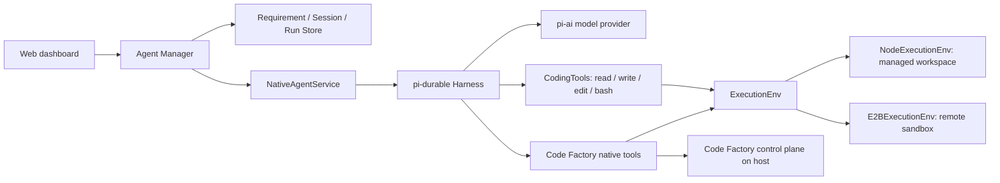

# Native Agent Implementation

Native Agent is Code Factory's third RD Agent provider. It uses pi-durable for persistent conversations. It shares Code Factory's Requirement, AgentSession, AgentRun, message, and pull request state machines with the headless Codex and Claude Code adapters, while a pi-durable Harness inside Agent Manager runs its model loop and dispatches its tools.

This guide covers the Native Agent core and its E2B execution environment extension. See the [architecture](architecture.en.md) and [API reference](agent-manager-api.md) for the canonical business state and HTTP contracts.

## Runtime location and call flow

**The Agent runs on the host; the sandbox is the tools' execution environment.** Agent Manager hosts the model client, Harness, conversation SQLite database, model credentials, and Code Factory control-plane tools. With E2B selected, CodingTools perform file and command operations remotely through the E2B SDK. The Agent runtime does not move into the sandbox. `ExecutionEnv` is a shared backend for tools such as `read`, `write`, `edit`, and `bash`, rather than a separate tool chosen by the model.

[`NativeAgentService`](../packages/agent-manager/src/native-agent.ts) opens one workspace-level Harness. It creates or resumes a pi-durable conversation for each Requirement and stores the conversation ID as `AgentSession.nativeSessionId`. Requirements have separate conversations, while later Runs of one Requirement resume its conversation.

## RD Run lifecycle

1. Agent Manager reads unconsumed Human, Reviewer, and selected System inputs from `requirement_messages`, creates an `AgentRun`, and resolves its model, reasoning effort, and `sandboxId`.
2. NativeAgentService creates or resumes the conversation, configures its model, `cwd`, and RD instructions, and submits the input to pi-durable. The default model is `openai/gpt-5.4`; model IDs use `provider/model` format.
3. The Harness calls the model through pi-ai. The model invokes CodingTools or Code Factory native tools. Harness events become Code Factory messages and tool traces, exposed through ManagerEvents, SSE, and the dashboard.
4. Agent Manager advances the RD message-consumption cursor only after a successful Run. Failed, timed-out, or interrupted Runs retain their input for a later retry. A Session has at most one active RD Run; different Requirements may run concurrently.

The pi-durable conversations live in the workspace's `native-agent.sqlite`. Requirement, Run, and message records live in Agent Manager's Store. These persistence layers hold model context and product state, respectively.

## Model authentication

The dashboard's **Agent Manager configuration → Runtime settings → Native Agent API profiles** panel adds saved items with OpenAI-compatible or Anthropic format, base URL, API key, and model name. Each Native Agent Requirement selects one item instead of choosing a model from the catalog. The key is stored in the separate owner-only `native-agent-auth.sqlite` file; list and save responses expose only the item ID, format, URL, and model name. The selected item is resolved when a Run starts, so profile changes apply to later Runs without restarting Agent Manager. Existing saved OpenAI and Anthropic API keys are added as profiles on upgrade. Older Requirements configured with direct provider/model IDs can use those saved API keys or process environment API keys. Subscription login is unavailable.

## Workspaces and execution environments

| Selection | Where files and commands run | Where the conversation and model client run |
| --- | --- | --- |
| Default / named local workspace | The Manager startup directory or selected existing local directory, without process isolation | Agent Manager host |
| E2B cloud sandbox | The SDK default user directory (or a legacy saved directory) through `E2BExecutionEnv` | Agent Manager host |

The Workspaces page includes a built-in Default workspace that cannot be edited or deleted. It manages named local workspaces and creates or attaches E2B sandboxes. E2B creation takes a name, `E2B_DOMAIN`, and `E2B_API_KEY`; template, existing sandbox ID, and environment variables are advanced options. Environment variables can also be added, replaced, or removed when editing a sandbox. Saved values are not shown again; blank edit values keep the saved value, and removing a row removes that configured variable. Saved names are read-only; to rename a variable, remove it and add a new row with its value. Values are stored with the API key in the owner-only credential sidecar, while workspace responses and Agent instructions contain only names. Native RD and Reviewer commands receive these variables through command-scoped SDK environment settings on every Run, including after reconnect and resume. Variables are not installed as global sandbox startup settings, so updating or removing overrides applies to later Code Factory commands. Agents and processes running those commands can access their values. `GH_TOKEN` is read by `gh`; plain HTTPS Git authentication also needs a credential helper, configured by the Agent as needed. Provisioning does not prepare code, require a Git checkout, or validate GitHub tools and authentication. New E2B records have null `cwd` and `repositoryUrl`; commands omit the SDK `cwd` option and relative file paths use the sandbox user directory discovered remotely with `pwd` when an Agent runs. RD Agents inspect existing files and reuse or clone repositories according to the Requirement. Reviewers read PR metadata and diffs through the GitHub CLI/API without requiring a checkout. Each command is independent, so use explicit paths or `cd` within repository commands. Legacy saved directories and repository metadata remain available for compatibility. The API key is stored in an owner-only credential file, separate from the application database. Lifecycle actions check status, pause, resume, and delete a sandbox. Native Reviewers use the Requirement's E2B environment with a fresh conversation and need no Codex or Claude Code CLI in the sandbox.

Multiple Native Agent Requirements may select the same E2B sandbox. They then share files and command environment, **not pi-durable conversations**. Concurrent Agents in one sandbox can edit the same file; selecting a sandbox does not create separate Git worktrees or resolve conflicts automatically. Selecting different sandboxes gives Requirements separate remote files. The E2B `ExecutionEnv.id` identifies a remote filesystem by domain and sandbox ID so pi-durable can coordinate file operations against that filesystem.

## Steering and stopping

A normal reply is appended to the Requirement message stream first. New messages arriving during a Run queue without implicitly interrupting it. When a human explicitly requests Steering and newer input exists, Agent Manager queues it even if the Harness is still opening. Once the first submission is ready, NativeAgentService submits the new direction with pi-durable's `whenBusy: "steer"`. Attachment paths and metadata use the same message format as a new RD Run. Agent Manager advances the Run's input cursor only after pi-durable accepts that submission; an input that cannot be steered stays queued for a later Run. The model receives accepted Steering after the current tool round, and the same `AgentRun` continues. An explicit Stop Run aborts the conversation; if it arrives before the first submission, NativeAgentService skips that submission. Only a successful Run consumes its original input and accepted Steering messages.

## Native tools and the control-plane boundary

NativeAgentService installs CodingTools in the pi-durable registry and registers `pr_register`, `gh_pr`, `requirement_propose`, `requirement_action`, `requirement_related`, `requirement_message`, `timer_register`, `timer_show`, and `timer_cancel`. These tools have typed parameters, so the model does not need to construct CLI commands from appended system-prompt instructions.

Requirement, timer, and PR registration tools reuse `code-factory-cli` validation and HTTP behavior on the Agent Manager host. The `pr_register` GitHub metadata lookup also uses the host's `gh`. The `gh_pr` tool runs through the selected `ExecutionEnv`, so with E2B it invokes `gh pr` in the remote repository. After creating a PR or changing its metadata, the Agent must still call `pr_register`. The GitHub reconciler owns the PR's draft, open, closed, and merged lifecycle state.

The boundary matters: E2B isolates file and shell operations routed through `ExecutionEnv`, **not Agent Manager or every native tool**. Model API credentials stay on the host. New sandboxes have no repository binding and do not automatically receive the Manager host's GitHub token; configure sandbox environment variables or prepare remote credentials when the task needs them. Explicit sandbox `GH_TOKEN` or `GITHUB_TOKEN` settings take precedence over legacy host-token forwarding. Legacy sandbox records retain repository metadata and the previous host-token forwarding behavior scoped to exactly `github.com`. Local execution inherits the launching user's local permissions, as the other local headless Agents do.

## Why this design fits Code Factory

Keeping the Harness, conversations, and control plane in Agent Manager lets one process coordinate long-lived Requirement sessions, message cursors, Steering, PR registration, and several Agents sharing a sandbox. Switching between local execution and E2B changes the `ExecutionEnv` without distributing model credentials to every sandbox.

Running the entire Agent inside a sandbox would make sense if the isolation requirement expands to **the Agent runtime, plugins, and every tool**. That design would also need an Agent runtime in each sandbox, model credential distribution, remote process recovery, conversation persistence, a control-plane connection, and concurrency coordination when several Agents share one sandbox. The current isolation of remote CodingTools should not be treated as isolation of the entire Agent.
